<p align="center">
  <a href="https://robbyczesany.com"></a>
</p>

<p align="center">
  <a href="https://robbyczesany.com"></a>
  <a href="https://websearchplus.xyz"></a>
  <a href="https://activityplus.xyz"></a>
  <a href="https://hermesui.xyz"></a>
  <a href="https://pocketui.xyz"></a>
  <a href="mailto:robby@robbyczesany.com"></a>
</p>

| **442★** | **88k+** | **12** | **19** |
| :-- | :-- | :-- | :-- |
| web-search-plus for Hermes | ClawHub skill downloads (2026-11-07) | published agent skills | merged PRs in OpenClaw core |

I build tools that tell you what is actually going on: on your Mac, your phone, your servers and inside your AI agents. `pocket-ui` is a cozy frontend with its own player for retro handhelds. Activity+ names the app behind every spike, on the Mac and on Android. Web Search Plus gives agents the original links instead of a made-up answer and runs in [Hermes](https://github.com/NousResearch/hermes-agent), [Grok Build](https://github.com/xai-org/plugin-marketplace/pull/499) (submitted), [NanoClaw](https://github.com/nanocoai/nanoclaw), [OpenClaw](https://github.com/openclaw/openclaw) and any MCP client.

## Work

### 🎮 [`pocket-ui`](https://pocketui.xyz) · featured

<a href="https://pocketui.xyz"></a>

**A cozy frontend with its own player for retro handhelds.** Every game sits in its real box on one shelf. Press A and you are playing, right where you left off. One pause menu works from Game Boy to GameCube, with saves that come with pictures and "Earlier" to go back a few minutes. Send games from your phone with a QR code, and updates over Wi-Fi keep your games and saves.

Free and open source (GPLv2, Rust). No account, no ads, no tracking; you bring your own games. Runs on [ROCKNIX](https://rocknix.org) handhelds: Retroid Pocket Mini V2, Mini, 5, 6, Flip 2 and Nova; AYN Odin 2 Mini, Odin 2 and Portal; Anbernic RG35XX, RG40XX, RG34XX, RG28XX and RG-SP. Next is 0.3 with a Retro look and a TrimUI Brick card, coming soon.

→ [pocketui.xyz](https://pocketui.xyz) · [pocket-ui](https://github.com/robbyczgw-cla/pocket-ui) · [0.2.4 release](https://github.com/robbyczgw-cla/pocket-ui/releases/tag/v0.2.4)

### 🔎 [Web Search Plus](https://websearchplus.xyz) · flagship

Search for agents that returns the original links and the cleaned page, never a generated answer. It picks a provider per query, falls back when one fails, and the MCP server covers 15 search and 9 extract providers.

```bash
hermes plugins install web-search-plus --enable          # Hermes, official plugin catalog
uvx --from web-search-plus-mcp==5.1.6 web-search-plus-mcp # any MCP client
```

[hermes-web-search-plus](https://github.com/robbyczgw-cla/hermes-web-search-plus) (5.1.7) · [web-search-plus-mcp](https://github.com/robbyczgw-cla/web-search-plus-mcp) (5.1.6) · [OpenClaw plugin](https://github.com/robbyczgw-cla/web-search-plus-plugin) · [NanoClaw](https://github.com/robbyczgw-cla/nanoclaw-web-search-plus)

### 📊 [Activity+](https://activityplus.xyz) · flagship

A system monitor that names the app responsible, keeps 30 days of history and answers "why is my Mac slow?" with a finding and a fix button. Agents get the same data through a read-only MCP server with 19 tools. Mac: Swift, MIT, notarized, `brew install robbyczgw-cla/tap/activity-plus`. No account, no analytics.

**Android** tells you which app drains the battery or keeps the phone awake at night. 0.6.4 (7 Nov) makes "who woke the phone" work on phones with hundreds of apps and leaves out impossible battery values from odd phones; the card says how many apps are missing. No internet permission.

→ [Mac 0.5.0](https://github.com/robbyczgw-cla/activity-plus/releases/tag/v0.5.0) · [Android 0.6.4](https://github.com/robbyczgw-cla/activity-plus-android/releases/tag/v0.6.4) · [activity-plus](https://github.com/robbyczgw-cla/activity-plus) · [activity-plus-android](https://github.com/robbyczgw-cla/activity-plus-android) · [1-minute film](https://activityplus.xyz/assets/video/activityplus-trailer.mp4)

### 🧩 Hermes

Three pieces around [Hermes Agent](https://github.com/NousResearch/hermes-agent):

- **[Web Search Plus](https://github.com/robbyczgw-cla/hermes-web-search-plus)** 5.1.7: the search plugin above, 442★.
- **[HUI+ · Hermes UI+](https://hermesui.xyz)** 0.3.1: a chat app for your own Hermes on Android, web (PWA), macOS and Linux. 0.3 brings bots onto one timeline, cards that say when facts are model knowledge, and replies to a single message. MIT, alpha, unofficial. [hermes-ui-plus](https://github.com/robbyczgw-cla/hermes-ui-plus)
- **[HUI+ Cards](https://github.com/robbyczgw-cla/hermes-ui-cards)** 0.1.0, new today: Hermes asks with a card, you tap, and your answer is the next message. 17 card types (plan, review, checklist, compare, form, quiz and more), desktop and webapp, text fallback elsewhere. Needs Hermes 0.22.6 or newer. MIT, no network access, no telemetry.

```bash
hermes plugins install robbyczgw-cla/hermes-ui-cards --enable
```

### 🌙 Skills

Skills that watch, remember and propose. Nothing lands until you approve it.

| Skill | What it does |
| :-- | :-- |
| [lucid-dreamer](https://clawhub.ai/robbyczgw-cla/lucid-dreamer) | Reviews agent memory every night, finds patterns, proposes changes |
| [skillminer](https://clawhub.ai/robbyczgw-cla/skillminer) | Finds work that keeps repeating and drafts a skill for it; never activates itself |
| [topic-monitor](https://clawhub.ai/robbyczgw-cla/topic-monitor) | Watches topics on a schedule and scores each item; in [DigitalOcean's OpenClaw skills guide](https://www.digitalocean.com/resources/articles/what-are-openclaw-skills) |
| [roundtable](https://clawhub.ai/robbyczgw-cla/roundtable) | Runs three agents in parallel and makes them cross-examine each other |

Also: [personas](https://github.com/robbyczgw-cla/clawdbot-personas), [agent-chronicle](https://clawhub.ai/robbyczgw-cla/agent-chronicle), [OpenCami](https://github.com/robbyczgw-cla/opencami) (web client for OpenClaw).

## Upstream

- **Nous Research:** web-search-plus in the [Hermes plugin catalog](https://hermes-agent.nousresearch.com/docs/plugins); co-author of the [prompt-cache fix](https://github.com/NousResearch/hermes-plugin-claude-subscription-directsdk/commit/d032bed) in the Claude subscription plugin
- **OpenClaw:** 19 merged PRs in core: Telegram, Discord, sessions, formatting, OpenRouter thinking
- **Lists:** [awesome-openclaw-skills](https://github.com/VoltAgent/awesome-openclaw-skills), [awesome-hermes-agent](https://github.com/0xNyk/awesome-hermes-agent)

## Now

- **Mac** · Activity+ 0.5.0
- **Android** · Activity+ 0.6.4
- **Handheld** · [`pocket-ui`](https://pocketui.xyz) 0.2.4
- **Agents** · Web Search Plus 5.1 (442★)
- **Hermes** · HUI+ 0.3.1 and HUI+ Cards 0.1.0 (first release today)

**Stack:** Go · Python · TypeScript · React / React Native · Tauri · Node · Vite · Expo · SQLite · Docker / Colima · MCP

<sub>Graz, Austria (CET) · open to agent-infrastructure work: robby@robbyczesany.com</sub>
