<p align="center">
  <a href="https://robbyczesany.com"></a>
</p>

<p align="center">
  <a href="https://robbyczesany.com"></a>
  <a href="https://websearchplus.xyz"></a>
  <a href="https://activityplus.xyz"></a>
  <a href="https://hermesui.xyz"></a>
  <a href="mailto:robby@robbyczesany.com"></a>
</p>

| **436★** | **91k+** | **12** | **19** |
| :-- | :-- | :-- | :-- |
| web-search-plus for Hermes | ClawHub skill downloads | published agent skills | merged PRs in OpenClaw core |

I build tools that tell you what is actually going on: on your Mac, your phone, your servers and inside your AI agents. Web Search Plus gives agents the original links instead of a made-up answer and runs in [Hermes](https://github.com/NousResearch/hermes-agent), [Grok Build](https://github.com/xai-org/plugin-marketplace), [NanoClaw](https://github.com/nanocoai/nanoclaw), [OpenClaw](https://github.com/openclaw/openclaw) and any MCP client. Activity+ names the app behind every spike, on the Mac and on Android.

## Work

### 🔎 [Web Search Plus](https://websearchplus.xyz) · flagship

Search for agents that returns the original links and the cleaned page, never a generated answer. It picks a provider per query, falls back when one fails, and attaches a routing receipt to every result. 15 search and 9 extract providers; one key is enough.

```bash
hermes plugins install web-search-plus --enable          # Hermes, official plugin catalog
uvx --from web-search-plus-mcp==5.0.1 web-search-plus-mcp # any MCP client
grok plugin install robbyczgw-cla/web-search-plus-mcp     # Grok Build
```

[hermes-web-search-plus](https://github.com/robbyczgw-cla/hermes-web-search-plus) · [web-search-plus-mcp](https://github.com/robbyczgw-cla/web-search-plus-mcp) ([PyPI](https://pypi.org/project/web-search-plus-mcp/), 1.2k downloads last month) · [OpenClaw plugin](https://github.com/robbyczgw-cla/web-search-plus-plugin) · [NanoClaw](https://github.com/robbyczgw-cla/nanoclaw-web-search-plus)

### 📊 [Activity+](https://activityplus.xyz) · flagship

A system monitor that names the app behind the load. It folds about 900 processes into the 80 or so apps you recognize, keeps 30 days of history, answers "why is my Mac slow?" with a finding and a fix button, and lists dev servers per project with their ports. Version 0.4 adds a storage map: where the space went, what grew since the last scan, and a cleanup list with a reason for every item. Agents get the same data through a read-only MCP server (`aplus mcp`). Swift, MIT, notarized, Apple silicon, macOS 15+. No account, no analytics.

**Android** (since 9 October): which app drains the battery or keeps the phone awake at night, a night check every morning, a battery passport, charging in watts, where storage went, widgets and 30 days of history. No internet permission. Kotlin, MIT, Android 10+.

| | Current | Recent releases |
| :-- | :-- | :-- |
| Mac | [0.4.1](https://github.com/robbyczgw-cla/activity-plus/releases/tag/v0.4.1) (23 Oct) | 0.4.0 storage map and cleanup · 0.3.0 why it was slow, freezes with call stacks, SSD wear · 0.2.3 safety release after a code review |
| Android | [0.6.0](https://github.com/robbyczgw-cla/activity-plus-android/releases/tag/v0.6.0) (21 Oct) | 0.5.0 night check, sensor log · 0.4.0 who woke the phone, battery passport · 0.3.0 storage page |

→ [activityplus.xyz](https://activityplus.xyz) · [activity-plus](https://github.com/robbyczgw-cla/activity-plus) · [activity-plus-android](https://github.com/robbyczgw-cla/activity-plus-android) · [1-minute film](https://activityplus.xyz/assets/video/activityplus-trailer.mp4)

### 📱 [HUI+ · Hermes UI+](https://hermesui.xyz) · new

A chat app for your own [Hermes Agent](https://github.com/NousResearch/hermes-agent) where an answer is something you act on: tick a checklist, pick an option, compare products, fill in a form. Each tap goes back to Hermes as the next message. When Hermes wants to run a command, the phone shows the command, the reason and an estimated risk, and you allow or deny it; tool steps appear live while they run. About 50 answer card types. Android, web (PWA, also on iPhone), macOS and Linux. The app reaches your Hermes through a small bridge on your tailnet: no hosted service, no account. MIT, alpha, unofficial.

```bash
npx hermes-ui-plus-bridge setup   # on the machine that runs Hermes; prints a pair QR code
```

→ [hermesui.xyz](https://hermesui.xyz) · [hermes-ui-plus](https://github.com/robbyczgw-cla/hermes-ui-plus) · [releases](https://github.com/robbyczgw-cla/hermes-ui-plus/releases)

### 🌙 Memory and autonomy

Skills that watch, remember and propose. Nothing lands until you approve it.

| Skill | What it does |
| :-- | :-- |
| [lucid-dreamer](https://clawhub.ai/robbyczgw-cla/lucid-dreamer) | Reviews agent memory every night, finds patterns, proposes changes |
| [skillminer](https://clawhub.ai/robbyczgw-cla/skillminer) | Finds work that keeps repeating and drafts a skill for it; never activates itself |
| [topic-monitor](https://clawhub.ai/robbyczgw-cla/topic-monitor) | Watches topics on a schedule and scores each item; in [DigitalOcean's OpenClaw skills guide](https://www.digitalocean.com/resources/articles/what-are-openclaw-skills) |
| [roundtable](https://clawhub.ai/robbyczgw-cla/roundtable) | Runs three agents in parallel and makes them cross-examine each other |

Also: [agent-chronicle](https://clawhub.ai/robbyczgw-cla/agent-chronicle), [OpenCami](https://github.com/robbyczgw-cla/opencami) (web client for OpenClaw), [OpenAgentFleet](https://github.com/robbyczgw-cla/openagentfleet) (macOS app for agents on a separate Linux machine; paused).

## Upstream

- **Nous Research:** web-search-plus in the [Hermes plugin catalog](https://hermes-agent.nousresearch.com/docs/plugins); co-author of the [prompt-cache fix](https://github.com/NousResearch/hermes-plugin-claude-subscription-directsdk/commit/d032bed) in the Claude subscription plugin
- **OpenClaw:** 19 merged PRs in core: Telegram, Discord, sessions, formatting, OpenRouter thinking
- **Lists:** [awesome-openclaw-skills](https://github.com/VoltAgent/awesome-openclaw-skills), [awesome-hermes-agent](https://github.com/0xNyk/awesome-hermes-agent)

## Now

- **Mac** · Activity+ 0.4.1: where the disk space went, a cleanup list with reasons
- **Android** · Activity+ 0.6.0: the night check and a battery passport
- **Handheld** · Pocket UI: a frontend for retro handhelds, in progress
- **Agents** · Web Search Plus: original sources for agents, 436★
- **Hermes** · Hermes UI+ 0.2.1: tick, choose and approve inside the answer

**Stack:** Go · Python · TypeScript · React / React Native · Tauri · Node · Vite · Expo · SQLite · Docker / Colima · MCP

<sub>Graz, Austria (CET) · open to agent-infrastructure work: robby@robbyczesany.com</sub>
